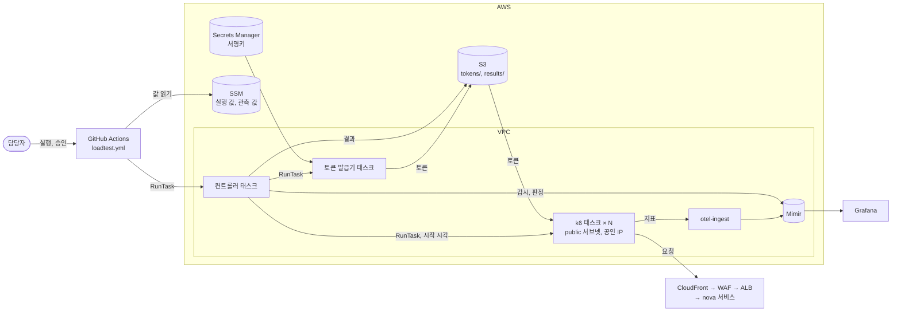
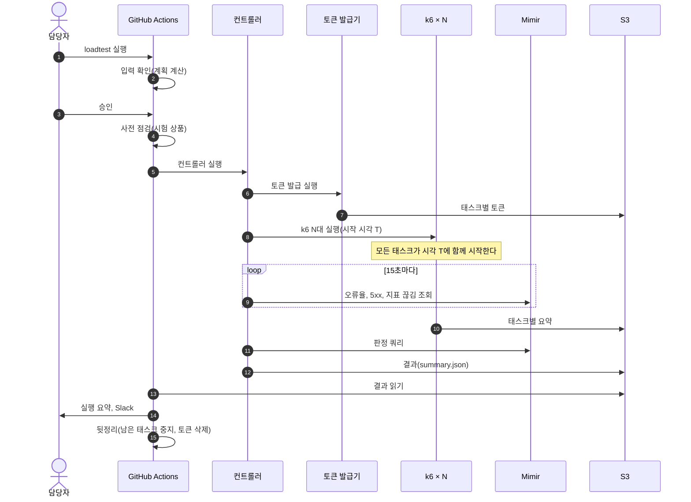
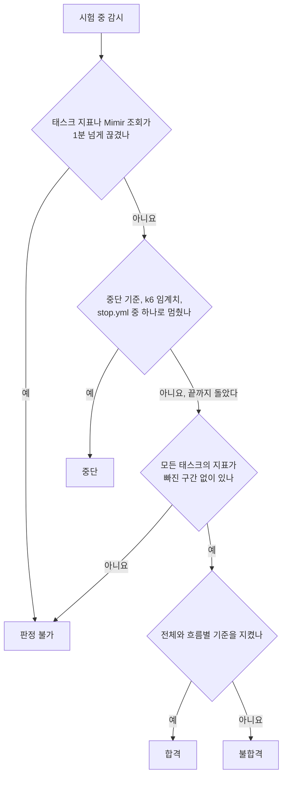
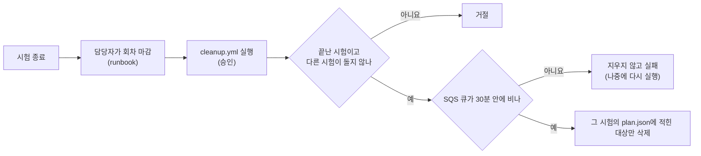

# 부하 시험 계획

이 문서는 nova의 부하 시험에서 무엇을 왜 하는지 설명한다. 각 결정을 지키기 위한 규칙과 근거는 [docs/design.md](docs/design.md)에, 만들 파일과 작업 단위는 [docs/implementation-plan.md](docs/implementation-plan.md)에 있다.

## 목표

1. 판매가 열리는 순간의 몰림(10초 동안 진입 5,000건)과 그 뒤에 이어지는 꾸준한 유입을 운영 경로 그대로 재현한다.
2. 시험 회원을 따로 두어, 대기열 입장권이나 "상품 하나에 회원 한 명당 예약 1건" 같은 제약이 실제와 똑같이 걸리게 한다.
3. 시험 결과를 Grafana에서 서비스, 업무, MySQL 대시보드와 같은 시간대에 놓고 비교한다.
4. breakscale 시뮬레이션에서 세운 가설을 실제 부하로 확인한다.
   - 접수 한도(초당 약 200건)를 만드는 원인이 회차 행 잠금인지, 커넥션 왕복 시간인지
   - 이벤트 소비기(동시 1)가 건당 약 7.8ms 안에 처리를 끝내서 worker 4대의 속도를 따라가는지
   - worker의 등록 처리량이 Mock 지연에 따라 어떻게 달라지는지, worker의 스케일 기준(`per_task: 50`)이 적절한지

## 주요 결정

| 항목 | 결정 | 이유 |
|---|---|---|
| 도구 | k6 (`grafana/k6:2.3.0` 고정) | 도착률을 기준으로 부하를 만들기 때문에 몰림을 정확하게 재현할 수 있다. Grafana, Mimir와도 바로 연결된다 |
| 실행 위치 | ECS Fargate의 시험 전용 클러스터 | 평소에는 0대로 두고 시험할 때만 띄우므로, 대수와 크기를 필요한 만큼 바로 늘릴 수 있다 |
| 부하 경로 | CloudFront → WAF → ALB → 서비스 | 실제 사용자가 지나가는 경로이다. ALB는 CloudFront 대역에서 원본 확인 헤더를 달고 온 요청만 받기 때문에, ALB로 직접 보낼 수도 없다 |
| 실행 방법 | GitHub Actions 수동 실행 | 상시로 띄워 둘 서버가 필요 없다. OIDC를 쓰므로 장기 키가 없고, 누가 어떤 값으로 실행했는지 기록이 남는다 |
| 회원과 토큰 | 시험 회원을 DB에 미리 넣고, 토큰은 AWS 안에서 직접 발급한다 | 카카오 로그인은 자동화할 수 없다. 서명키는 AWS 밖으로 꺼내지 않는다 |
| 시험 상품 | 시험마다 새 시험 상품과 회차를 만든다 | 예약은 상품 하나에 회원 한 명당 1건만 가능하고, 회차는 열린 뒤에 바꿀 수 없다 |
| 결제 | 주문 생성과 결제 시도 생성까지만 보낸다 | 결제 승인에 필요한 `paymentKey`는 토스 결제창에서 인증해야 만들어지므로, 운영 경로로는 만들 수 없다 |
| 저장소 | 도구는 이 저장소에, 인프라는 nova-infra에 둔다 | WAF, 게이트웨이처럼 기존 스택을 고쳐야 하고, 인프라 적용은 Atlantis가 맡는다 |

## 전체 구조

- 컨트롤러는 VPC 안에서 태스크로 돈다. GitHub 러너는 VPC 밖에 있어 Mimir를 조회할 수 없고, Grafana는 Cognito 로그인 뒤에 있기 때문이다. 러너는 컨트롤러를 띄운 뒤 기다렸다가, S3에 남은 결과를 읽어 실행 요약에 옮긴다.
- k6는 public 서브넷에서 공인 IP를 받아 돈다. NAT는 작은 인스턴스 두 대라서, 큰 부하를 NAT로 보내면 서비스보다 NAT가 먼저 막힌다.
- k6의 요청에는 부하 시험 헤더가 붙는다. WAF는 이 헤더가 붙은 요청에만 IP당 요청 제한을 적용하지 않는다.

## 시험 한 번의 흐름

1. **입력 확인**: 입력한 값과 시나리오 기본값으로 계획을 계산한다. 계획에는 흐름별 도착률, 태스크 대수, 필요한 회원 수, 최대 VU, 예상 시계열 수가 들어간다. 상한을 넘거나 회원이 모자라면 실행하지 않고 멈춘다.
2. **승인**: `loadtest` environment의 승인자가 승인해야 다음 단계로 넘어간다. 운영에 부하를 보내는 일이므로 사람이 한 번 확인한다.
3. **사전 점검**: 시험 상품이 판매 중인지 공개 API로 확인한다. 러너가 볼 수 없는 회차 일정, 경보 상태, 시험 회원 준비 여부는 승인자가 runbook의 점검표로 확인한다.
4. **컨트롤러 실행**: 컨트롤러가 토큰 발급기와 k6를 띄우고, 시험 내내 Mimir를 조회하면서 감시한다. 시험이 끝나면 Mimir로 판정하고 결과를 S3에 쓴다.
5. **결과 정리**: 실제로 보낸 부하, p95, p99, 오류율, 실행기 CPU, 판정 결과, 시험 시간대를 맞춘 Grafana 링크를 실행 요약과 Slack에 남긴다.
6. **뒷정리**: 시험이 실패하거나 취소되어도 이 단계는 실행된다. 남은 태스크를 멈추고 토큰을 지운다. 시험 데이터는 이 단계에서 지우지 않는다(아래 "시험 데이터").

같은 시간에는 시험을 하나만 돌린다. 시험 하나는 최대 6시간이다. GitHub Actions의 작업 하나가 6시간까지만 돌 수 있기 때문이다.

## 워크플로

| 워크플로 | 언제 | 하는 일 |
|---|---|---|
| `ci.yml` | PR을 올릴 때 | 워크플로 검사, 린트, 단위 테스트, k6 스크립트 검사, 이미지 빌드와 k6 안전장치 시험 |
| `build.yml` | main에 push 할 때 | k6, 컨트롤러, 토큰 발급기 이미지를 빌드해 ECR에 올린다 |
| `loadtest.yml` | Actions 탭에서 손으로 실행 | 입력을 받아 시험을 한 번 돌린다. 승인이 필요하다 |
| `stop.yml` | Actions 탭에서 손으로 실행 | 시험 ID로 도는 k6 태스크를 모두 멈춘다. 승인 없이 바로 돈다 |
| `cleanup.yml` | 담당자가 회차를 마감한 뒤 실행 | 시험 ID의 시험 데이터를 지운다. 승인이 필요하다 |

`loadtest.yml`의 입력은 다음과 같다. 필요한 회원 수는 시나리오와 부하에 따라 크게 달라지므로, 입력받지 않고 계획을 계산할 때 구한다.

| 입력 | 기본값 | 설명 |
|---|---|---|
| `scenario` | `smoke` | smoke, load, spike, rush, stress, soak 중 하나 |
| `product_id` | 없음 | 진입과 접수에 쓰는 시험 상품 ID. 진입 흐름이 있으면 반드시 넣는다 |
| `prep_product_id` | `product_id` | 조회, 취소, 결제에 쓸 예약을 미리 만들어 둘 시험 상품 ID. spike에서는 따로 넣고, rush에서는 비운다 |
| `open_at` | 없음 | 회차가 열리는 시각(UTC). 넣으면 본 시험을 이 시각에 맞춰 시작한다. spike와 rush에서는 반드시 넣는다. 지금부터 1시간 안이어야 한다(기다리는 시간도 작업 6시간 상한과 토큰 유효 시간에 들어가기 때문이다) |
| `peak_rps` | 시나리오 기본값 | 초당 흐름 시작 수의 최대치(모든 흐름의 합계). 요청 수가 아니다 |
| `duration` | 시나리오 기본값 | 최대치를 유지하는 시간(예: smoke `2m`, load `30m`) |
| `ramp_up` | 시나리오 기본값 | 최대치까지 올리는 시간(예: load `1m`, spike `10s`) |
| `runners` | 자동 | k6 태스크 대수. 비워 두면 태스크 하나가 초당 1,000건을 맡는다고 보고 계산한다. 이 값은 smoke와 load에서 실측한 뒤 고친다 |
| `abort_error_rate` | `5` | 오류율이 이 값(%)을 1분 넘게 넘으면 시험을 멈춘다 |
| `flows` | 모두 | 돌릴 흐름(쉼표로 구분). 첫 smoke는 `catalog`만 넣어 토큰, 회원, 시험 상품 없이 돌린다 |

터미널에서는 `gh workflow run loadtest.yml -f scenario=spike -f product_id=<id> -f prep_product_id=<id> -f open_at=<UTC 시각> -f peak_rps=500`처럼 실행할 수 있다.

## 시나리오

시나리오는 모두 다섯 가지 흐름을 섞어 만든다(rush는 몰린 회원 한 명이 진입부터 결제 시도까지 이어 가는 흐름을 따로 쓴다). 평시 비율은 breakscale `01-평시`를 따르며, 초당 흐름 시작 수는 상품 조회 80, 예약 조회 10, 진입과 접수 5, 주문과 결제 시도 5, 예약 취소 1이다. 흐름별 API와 회원 풀은 [설계 세부 "흐름과 회원 풀"](docs/design.md#흐름과-회원-풀)에 있다.

| 시나리오 | 무엇을 보나 | 모양 | 기본값 | 필요한 회원 |
|---|---|---|---|---|
| smoke | 도구와 경로가 맞는지 | 평시 비율로 일정하게 | 초당 5, 2분 | 수백 명 |
| load | 평시의 몇 배까지 여유가 있는지 | 평시 비율 × 배수. 1분 동안 올리고 유지 | 2배, 30분 | 약 22,600명 |
| spike | 판매가 열리는 순간(breakscale 02) | 10초 동안 진입 5,000건, 뒤이어 10분 관찰 | `open_at` 기준 | 약 9,600명 |
| rush | 몰린 회원이 결제 시도까지 가는 판매 오픈 | spike와 같은 몰림. 절반이 등록 알림을 기다려 주문과 결제 시도까지 간다 | `open_at` 기준, 관찰 10분 | 약 5,000명 |
| stress | 어디가 먼저 막히는지 | 단계마다 배수를 올린다 | 1·2·4·6·8배, 단계마다 5분 | 약 38,800명 |
| soak | 오래 돌릴 때 새는 것(커넥션, 메모리, Valkey 키) | 평시 비율로 일정하게 | 1배, 4시간 | 약 87,400명 |

- 필요한 회원 수에는 진입용 회원(풀 A), 조회와 결제용 회원(풀 B, 1,000명), 취소용 회원(풀 C)이 모두 들어 있다. 계산 근거는 [설계 세부 "회원 수"](docs/design.md#회원-수)에 있다. 시험 회원은 10만 명을 미리 넣어 두고 시험마다 다시 쓴다.
- 진입은 초당 120건(입장 속도 150건의 80%)을 넘지 않게 묶는다. 진입이 입장 속도보다 빠르면 기다리는 회원이 계속 쌓이고, 그만큼 VU와 메모리가 끝없이 늘어나기 때문이다.
- smoke는 WAF 예외가 없어도 돌 수 있어야 한다(첫 smoke는 WAF 예외를 적용하기 전에 돈다). 그래서 k6 태스크(IP) 하나가 5분 동안 보내는 요청이 2,400건(WAF 제한 3,000건의 80%)을 넘지 않게 계획을 계산한다.
- 운영 설정을 바꿔야 확인할 수 있는 가설(접수 한도의 원인, Mock 지연)은 기본 시나리오를 마친 뒤 따로 승인받아 시험한다. 어떤 가설을 어느 시나리오로 보는지는 [설계 세부 "시나리오별 세부"](docs/design.md#시나리오별-세부)에 있다.

## 판정

합격 기준은 운영 SLO와 같다. 응답 시간 p95는 0.5초 이하, 5xx 비율은 0.1% 이하이다. 전체 요청의 80% 가까이가 상품 조회라서, 전체 기준과 함께 흐름별(진입과 접수, 조회, 결제, 취소) 기준도 모두 지켜야 합격이다.

k6 태스크가 여러 대라서 백분위를 태스크마다 따로 계산하면 합칠 수 없다. 그래서 응답 시간을 히스토그램으로 Mimir에 보내고, 컨트롤러가 Mimir에서 전체를 합쳐 판정한다.

- **중단 기준**: 오류율이 `abort_error_rate`(기본 5%)를 넘거나 5xx 비율이 1%를 넘는 상태가 1분 넘게 이어지면, 컨트롤러가 모든 k6 태스크를 멈춘다. 중단 기준은 합격 기준보다 느슨하다. 합격 기준을 조금 넘었다고 바로 멈추지 않고, 운영에 피해가 커지기 전에만 멈추려는 것이다. 컨트롤러가 죽어도 부하가 계속 나가지 않도록, k6 태스크도 같은 오류율 임계치에 걸리면 스스로 멈춘다.
- **stress**: stress는 기준을 넘는 지점을 찾는 시험이므로 합격이나 불합격 대신 "한계 측정"으로 끝난다. 결과에는 기준을 지킨 마지막 단계와, 처음 기준을 넘은 단계에서 먼저 막힌 곳(서비스, DB 풀, Valkey)을 적는다.
- 부하를 보내기 전에 멈추면 "취소"로 끝난다. 시작 시각까지 태스크가 모두 뜨지 않았거나, 태스크마다 이미지가 다르거나, 토큰 발급이 실패한 경우이다.
- 워크플로는 판정이 합격일 때만 성공한다. stress는 한계 측정이면 성공한다.

## 시험 회원과 토큰

- 카카오 로그인은 자동화할 수 없으므로, member의 서명키로 시험 회원의 토큰을 직접 만든다. 각 서비스는 서명, 클레임, 만료, 폐기 표시만 확인하므로 직접 만든 토큰도 그대로 통과한다.
- 토큰 발급기는 AWS 안에서 한 번 돌고 끝나는 태스크이다. 서명키는 이 태스크만 읽을 수 있고, AWS 밖으로 나가지 않는다.
- 발급기는 일반 회원(`role=USER`) 토큰만 만들고, 이미지에 고정된 시험 회원 ID 범위 밖의 요청은 거절한다. 실행할 때 범위를 넓혀 실제 회원의 토큰을 만들 수 없게 하려는 것이다.
- 누군가 발급기 코드나 설정, 워크플로를 바꿔 이 제한을 풀 수 없도록, 이 경로들은 main 브랜치 보호와 CODEOWNERS 리뷰를 거쳐야만 바꿀 수 있다.

## 시험 데이터

시험 회원은 be가 준 SQL로 한 번 넣어 두고 계속 쓴다. 시험 상품은 시험마다 담당자가 관리자 화면에서 만든다.

시험이 끝나도 worker의 등록과 취소, 이벤트 소비는 SQS에서 한동안 이어진다. 회차가 열려 있으면 실제 사용자가 진입할 수도 있다. 그래서 시험 데이터는 시험이 끝난 직후에 지우지 않고, 담당자가 회차를 마감한 뒤 `cleanup.yml`로 따로 지운다.

지울 대상은 입력으로 받지 않고 그 시험의 계획 파일(`plan.json`)에서 읽는다. spike는 진입용 상품과 준비용 상품을 따로 쓰므로 두 상품을 모두 마감하고 정리한다. ID를 잘못 입력해서 다른 데이터를 지우는 일을 막기 위해서이다. 지우는 테이블 목록은 [설계 세부 "정리"](docs/design.md#정리)에 있다.

## 인프라에서 받는 것

AWS 리소스는 nova-infra가 만들고, 이 저장소는 만들지 않는다. 인프라에 요청한 변경은 [구현 계획 3절](docs/implementation-plan.md#3-nova-infra-변경)에 있다.

| 받는 것 | 어디에 쓰나 |
|---|---|
| 시험 전용 ECS 클러스터와 작업 정의, SSM의 실행 값(`/nova-prod/loadtest/run-task`) | 컨트롤러, 토큰 발급기, k6를 띄운다 |
| SSM의 관측 값(`/nova-prod/loadtest/observability`) | k6의 지표 수집 주소와 Mimir 위치를 찾는다 |
| GitHub OIDC 역할 두 개(시험 실행용, 빌드와 중지용) | 워크플로가 AWS를 쓴다 |
| ECR, S3, Secrets Manager(서명키, 부하 시험 헤더) | 이미지, 토큰과 결과, 비밀을 둔다 |
| WAF 부하 시험 헤더 예외 | smoke를 뺀 시나리오에서 IP당 요청 제한을 피한다 |
| 시험 데이터 준비와 정리 태스크 | 시험 회원을 넣고, `cleanup.yml`이 시험 데이터를 지운다 |

## 안전장치

- 운영 환경에서 시험하므로, 시험 시간을 팀에 미리 알리고 사용자가 적은 시간대에 진행한다. 요청 급감, 급증, SLO 경보는 시험 시간에만 끈다. 시험 부하가 운영 SLO의 오류 예산을 쓴다는 점도 팀과 미리 합의한다.
- 시험 전에 오토스케일링 상한, DB 커넥션 한도, Valkey 크기, Mimir 시계열 사용량을 기록해 둔다. 이 값은 결과를 해석할 때 근거가 된다.
- 오류율이나 5xx가 기준을 넘거나 지표가 끊기면 컨트롤러가 모든 태스크를 멈춘다. 담당자는 `stop.yml`로 언제든지 직접 멈출 수 있다.
- 처음에는 smoke(초당 5건)로 시작하고, load, spike, stress, soak 순서로 부하를 올린다. 실행할 때마다 승인을 받는다.
- k6 지표는 운영과 같은 Mimir에 쌓인다. 시험 하나의 시계열을 2만 개 이하로 제한해서, 운영 지표가 Mimir 한도에 밀려 버려지지 않게 한다.
- 결제 승인은 보내지 않고, 대기열 입장권도 우회하지 않는다. worker의 외부 등록은 운영 Mock 서비스로 가므로 Mock DB에도 기록이 남는다.
- 시험 상품은 노출을 켜야 접수할 수 있어서 실제 사용자에게도 보인다. 그래서 이름에 시험용임을 밝히고, 회차는 시험 시간에만 열었다가 끝나면 바로 마감한다.
- 워크플로는 운영에 닿지 않도록 로컬 Forgejo(AWS는 moto, Mimir는 가짜 서버)에서 먼저 돌려 본다. 승인과 OIDC처럼 Forgejo에서 다르게 동작하는 부분은 GitHub의 첫 smoke에서 확인한다([구현 계획 7절](docs/implementation-plan.md#7-테스트와-로컬-ci)).
- 공개 저장소이므로 부하 시험 헤더 값, 토큰, 시험 회원 목록, 계정 ID가 들어간 ARN은 커밋하지 않는다. Actions 로그에도 이런 값이 찍히지 않게 가린다.

## 작업 순서

| 순서 | 티켓 | 작업 |
|---|---|---|
| 1 | NV-656 | 설계 문서, 저장소 뼈대와 CI, 로컬 Forgejo, main 브랜치 보호 |
| 2 | NV-657 | 시험 도구 구현(계획 계산, k6, 토큰 발급기, 컨트롤러, 워크플로). 인프라 없이 로컬에서 확인한다 |
| 3 | NV-658 | 운영 smoke와 runbook. 인프라와 be의 시험 회원 SQL이 준비된 뒤에 진행한다 |
| 4 | 없음 | load, spike, stress, soak. 티켓 없이 운영 작업으로 진행하고, 실행할 때마다 승인을 받는다 |

운영의 첫 시험은 상품 조회만 하는 smoke이다. 토큰, 회원, 시험 상품, WAF 예외가 없어도 돌릴 수 있으므로, 이미지와 실행 경로와 지표 경로를 먼저 확인할 수 있다. 그다음에 다섯 흐름을 모두 넣은 smoke를 돌린다.

## 정할 것

- [ ] 목표 부하(최대 흐름 시작 수)
- [ ] 시나리오 기본값(load 2배 30분, stress 1·2·4·6·8배 단계마다 5분, spike 관찰 10분, 진입 상한 120/초)과, 흐름별 기준을 합격 조건에 넣을지
- [ ] be에 시험 회원 SQL을 요청할 수 있는지, 시험 회원 ID 규칙과 회원 수(제안: 10만 명)
- [ ] 시험 상품 노출: 지금 방식대로 운영할지, be에 "목록에서 빠지는 시험 상품" 표시를 요청할지
- [ ] 결제 승인 부하를 따로 재야 하는지. 재야 한다면 운영이 아닌 환경에서 토스 주소를 WireMock으로 바꿔 잰다
- [ ] 시험 데이터 준비와 정리를 어떤 DB 계정으로 돌릴지. DB(NCP)에는 NAT의 고정 IP로만 접속할 수 있어서, 마이그레이션처럼 클러스터 안의 태스크로 돌려야 한다
- [ ] 계정의 Fargate vCPU 할당량과 운영 사용분(`runner.max_tasks`를 정한다)
- [ ] 결과 보관 기간 180일로 충분한지
