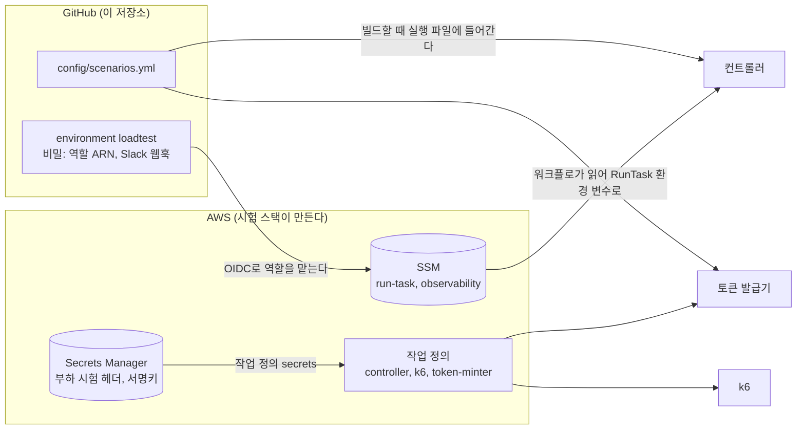

# 설정과 비밀 값

부하 시험에 쓰는 키, 비밀, 설정 값이 어디에 있고 누가 넣고 누가 읽는지를 한곳에 모았다. 값 자체는 적지 않는다. 공개 저장소이므로 비밀 값, 계정 ID가 들어간 ARN, 버킷 이름, 서브넷과 보안 그룹 ID는 이 저장소에 두지 않는다.

인프라 쪽 정의는 nova-infra의 `terraform/aws/loadtest/nova_apnortheast2`(이하 "시험 스택")에 있다. 아래 내용은 2026-10-19의 nova-infra main을 보고 적었다.

## 한눈에 보기

## GitHub에 두는 값

| 이름 | 종류 | 넣는 곳 | 쓰는 곳 | 내용 |
|---|---|---|---|---|
| `AWS_RUN_ROLE_ARN` | 비밀 | environment `loadtest` | `loadtest.yml`의 `run`, `cleanup.yml` | 역할 `nova-prod-loadtest-github-run`의 ARN |
| `AWS_BUILD_ROLE_ARN` | 비밀 | 저장소 | `build.yml`, `stop.yml`, `loadtest.yml`의 `plan` | 역할 `nova-prod-loadtest-github-build`의 ARN |
| `SLACK_WEBHOOK_URL` | 비밀 | environment `loadtest` | `loadtest.yml`의 결과 정리 | 결과를 보낼 Slack 채널 |

- 역할 ARN에는 계정 ID가 들어 있으므로 워크플로 파일에 적지 않고 비밀로 둔다.
- 장기 AWS 키는 두지 않는다. 워크플로는 OIDC로 역할을 맡는다.
- 값은 NV-658(운영 smoke) 전에 저장소 관리자가 넣는다.

### OIDC 신뢰 조건

- 이 저장소는 OIDC 토큰의 `sub`에 저장소 이름 대신 숫자 ID를 쓰는 immutable subject 형식을 쓴다(`gh api repos/Grandis-2/nova-loadtest/actions/oidc/customization/sub`로 확인). 그래서 `sub`는 `repo:Grandis-2@336932992/nova-loadtest@1423176487:…` 형태이다.
- 시험 실행 역할(`-github-run`)은 `…:environment:loadtest`만 받는다. environment `loadtest`에는 승인자와 "main만 배포" 규칙이 걸려 있다.
- 빌드 역할(`-github-build`)은 `…:ref:refs/heads/main`만 받는다.
- 저장소의 OIDC 설정을 바꾸면 `sub`가 달라져 두 역할을 모두 맡을 수 없게 된다. 바꾸려면 시험 스택의 `github_repo`도 같이 바꾼다.

## AWS Secrets Manager

| 비밀 | 만드는 곳 | 읽는 역할 | 들어가는 곳 |
|---|---|---|---|
| `nova-prod/ops/loadtest/header` | nova-infra secretsmanager 스택 | 실행 역할 `-execution` | k6 작업 정의의 `secrets` → 환경 변수 `LOADTEST_HEADER`. k6가 헤더 `x-nova-loadtest`에 넣는다. WAF(edge 스택)도 같은 값을 읽어 요청 제한 예외에 쓴다 |
| `nova-prod/app/member/JWT_PRIVATEKEY` | nova-infra secretsmanager 스택(member 서비스와 같이 씀) | 실행 역할 `-minter-execution` | 발급기 작업 정의의 `secrets` → 환경 변수 `JWT_PRIVATE_KEY`. RSA 2048 PKCS#8 PEM 문자열 하나(JSON이 아니다) |

- 부하 시험 헤더 값을 바꾸면 secretsmanager → edge 순서로 적용한다. 그 사이에는 k6가 옛 값을 보내 요청 제한에 막히므로 시험을 하지 않는다.
- 서명키는 AWS 밖으로 가져오지 않는다. 로컬 시험에서는 매번 새로 만든 시험용 키를 쓴다.

## 작업 정의에 고정된 값

시험 스택의 `ecs.tf`에 있다. 컨트롤러는 이 값을 덮어쓰지 않는다.

| 작업 정의 | 크기 | 환경 변수 | 그 밖 |
|---|---|---|---|
| `nova-prod-loadtest-controller` | 0.25 vCPU, 512MB | 없음(워크플로가 RunTask로 넣는다) | 실행 역할 `-execution` |
| `nova-prod-loadtest-k6` | 4 vCPU, 8GB | `K6_OTEL_EXPORTER_PROTOCOL=http/protobuf`, `K6_OTEL_HTTP_EXPORTER_INSECURE=true`, `K6_OTEL_SERVICE_NAME=k6`, `K6_OTEL_METRIC_PREFIX=k6_` | `stopTimeout` 120초, `nofile` 65536, 비밀 `LOADTEST_HEADER` |
| `nova-prod-loadtest-token-minter` | 0.5 vCPU, 1GB | `JWT_ISSUER`, `JWT_AUDIENCE`, `JWT_KEY_ID`(nova-infra `terraform/application/member/application.yml`의 `jwt`에서 읽는다) | 비밀 `JWT_PRIVATE_KEY`, 실행 역할 `-minter-execution` |

- 세 작업 정의 모두 `linux/amd64`(X86_64)이고, 이미지는 ECR `nova/loadtest-k6`, `nova/loadtest-controller`, `nova/loadtest-token-minter`의 `:latest`이다.
- `JWT_KEY_ID`는 헤더 `kid`에 그대로 들어간다. member 설정과 어긋나면 모든 요청이 401이 된다.

## SSM 파라미터

시험 스택의 `ssm.tf`에 있다. 비밀은 아니지만 계정마다 다른 ID가 들어 있어서 이 저장소에 적지 않는다. 워크플로의 `run` 작업이 읽어서 컨트롤러 RunTask의 환경 변수로 넘기고, 로그에는 가려서 남긴다([설계 세부 "인프라 값"](design.md#인프라-값)).

| 파라미터 | 컨트롤러 환경 변수 | 내용 |
|---|---|---|
| `/nova-prod/loadtest/run-task` | `RUN_TASK` | 클러스터, 버킷, 태스크별(`controller`, `tokenMinter`, `k6`) 작업 정의 패밀리, 컨테이너 이름, 서브넷, 보안 그룹, 공인 IP 여부 |
| `/nova-prod/loadtest/observability` | `OBSERVABILITY` | 지표 수집 주소(`otlpEndpoint`), Mimir를 찾을 클러스터, 서비스, 포트, 조회 경로 |

형식은 [구현 계획 2.5](implementation-plan.md#25-워크플로)에 있다.

## 실행할 때 넘기는 값

### 컨트롤러가 k6에 넘기는 값(RunTask 덮어쓰기)

`TEST_ID`, `TASK_INDEX`, `START_AT`, `SEGMENT`, `SEGMENT_SEQUENCE`, `PLAN_JSON`, `PRODUCT_ID`, `PREP_PRODUCT_ID`, `TOKENS_URI`, `BASE_URL`, `OTEL_RESOURCE_ATTRIBUTES`, `K6_OTEL_HTTP_EXPORTER_ENDPOINT`. 뜻은 [구현 계획 2.2](implementation-plan.md#22-k6-k6)에 있다.

### 컨트롤러가 토큰 발급기에 넘기는 값(RunTask 덮어쓰기)

| 환경 변수 | 내용 |
|---|---|
| `TEST_ID` | 시험 ID |
| `TOKENS_URI` | 토큰을 쓸 곳(`s3://<버킷>/tokens/<시험 ID>/`) |
| `MEMBERS` | 풀 A, B, C의 회원 번호 범위(JSON, 계획의 `members`) |
| `TASKS` | k6 태스크 수. 태스크마다 토큰 파일을 따로 만든다 |
| `TOKEN_TTL_SECONDS` | 토큰 유효 시간. 최대 6시간 30분 |

발급기는 회원 번호가 `config/scenarios.yml`의 시험 회원 범위 안인지 다시 확인한다. 이 범위는 빌드할 때 실행 파일에 들어가므로 실행 중에 바꿀 수 없다.

## 이 저장소의 설정

`config/scenarios.yml` 하나에 모두 있다. 흐름 비율, 시나리오 기본값과 상한, 실행기 크기, 시험 회원 범위, 시계열 상한, SLO와 중단 기준, 정리 전에 볼 큐(`preorder-register`, `preorder-cancel`, `preorder-events`, `order-events`), Mimir 지표 이름이다. 각 항목의 뜻은 [구현 계획 2.1](implementation-plan.md#21-configscenariosyml)에 있다.
